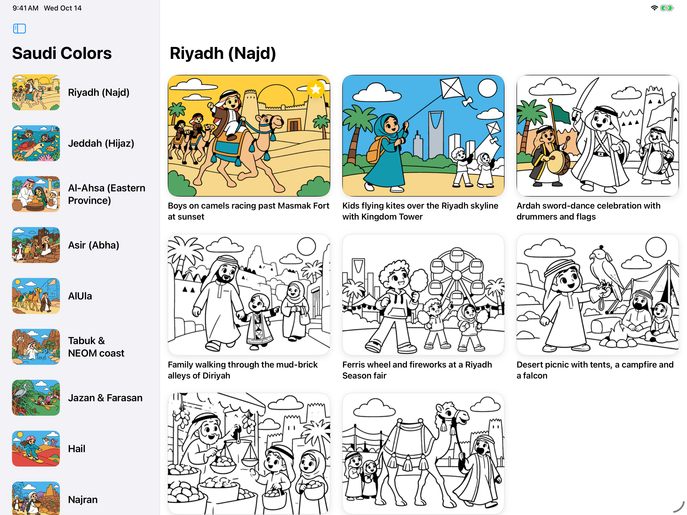
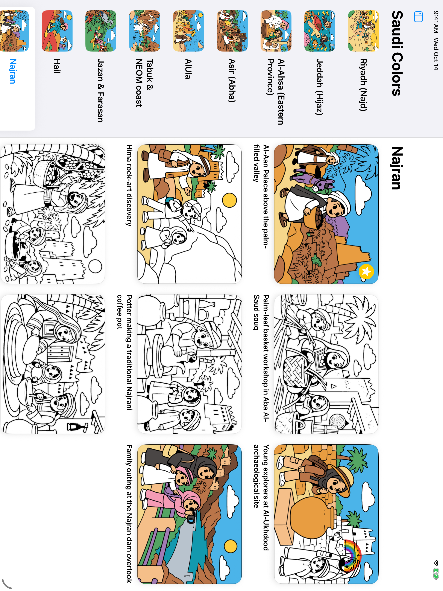
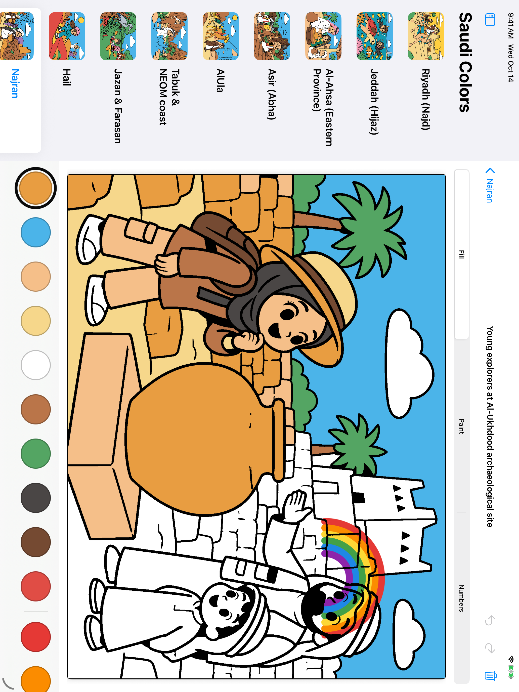
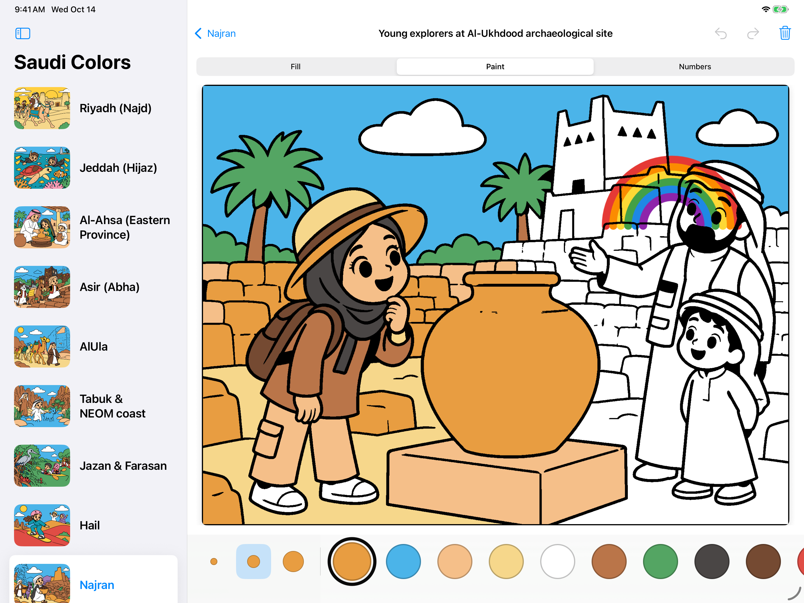
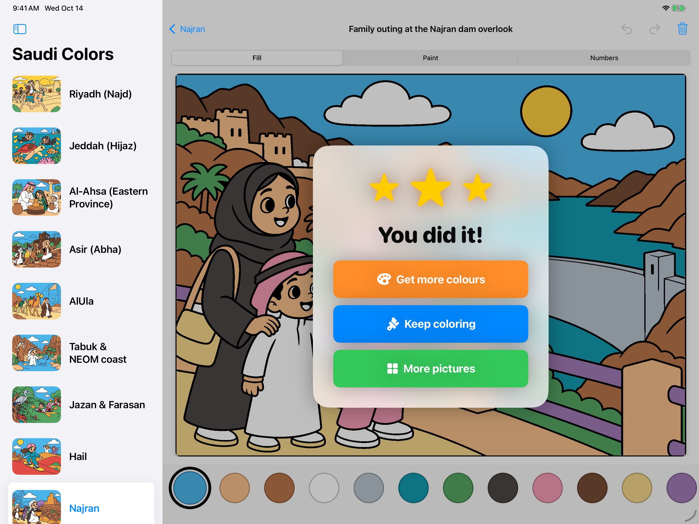
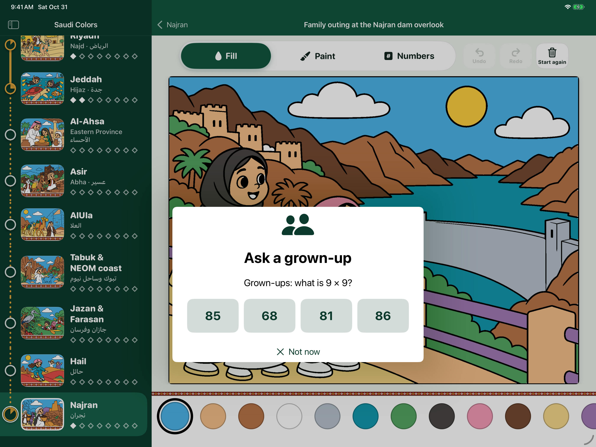
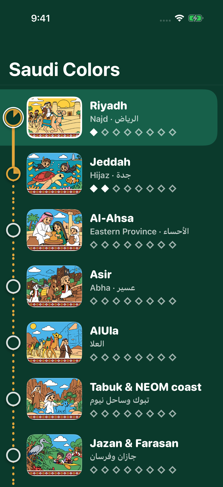
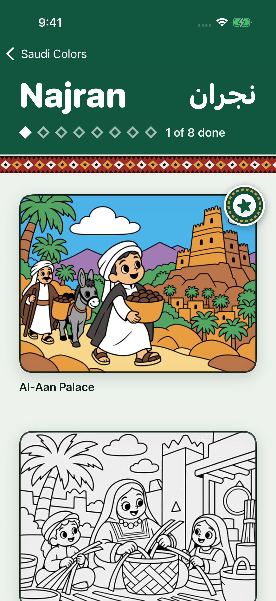
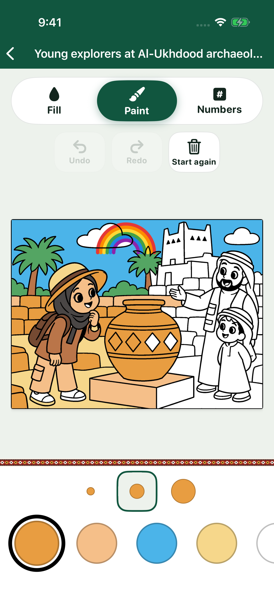

# Saudi Colors

A coloring book for kids (iPad first, iPhone too) built around the cities and cultures of Saudi Arabia: 8 regions, 8 scenes each, with two ways to colour: Fill (tap a shape) and Paint (a brush). Ad-supported.

- `CLAUDE.md` — how the code is organised and how to build/test.
- `docs/CONTENT_PLAN.md` — the 64 scenes.
- `docs/MONETIZATION.md` — ads and App Store Kids Category constraints.
- `docs/ROADMAP.md` — milestones to a first App Store release.
- `docs/TESTFLIGHT.md` — how builds reach TestFlight, and the one-time App Store Connect setup.

Quick start: `brew install xcodegen && xcodegen generate && open SaudiColoring.xcodeproj`.

## Screenshots

Taken on iPad (landscape) and iPhone (portrait, `phone-*.png`) simulators by `.github/workflows/screenshots.yml` (the `Screenshots` scheme, with demo progress). It runs on demand (Actions > App screenshots > Run workflow, on the branch you want) and pushes fresh PNGs to the branch `screenshots/<that branch>`.

| | |
|---|---|
|  |  |
|  |  |
|  |  |

On iPhone:

| | | |
|---|---|---|
|  |  |  |
